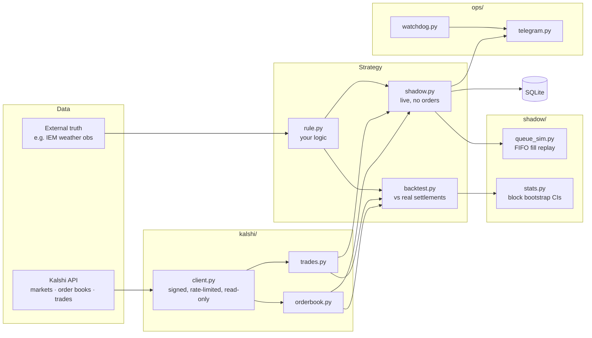

# kalshi-shadow-kit

**Test a Kalshi trading idea against real data before risking a dollar.**

A small, tested Python toolkit for building prediction-market bots shadow-first:
authenticated API client → backtest against real settlements → live shadow run that
simulates your fills in the real order queue → Telegram alerts and a watchdog.
It is **read-only by design**: there is no order-placing code in this repo.

It includes a complete worked example: a weather strategy that found a real edge, caught the
one sensor glitch that would have wiped it out, and showed why a small account still can't
capture it. Read [the findings](examples/weather_deadbucket/FINDINGS.md).

---

## Why shadow-first

Most bot code goes from idea to live orders. The expensive surprises turn up later:

- a rule that's right 1,110 times and wrong once, at -99c
- a settlement source that pays on a preliminary report
- a maker backtest showing millions of contracts of volume, while 225,000 contracts sit
  ahead of you in the queue

This kit tests for each of those before any order exists.

## Architecture



| Module | What it does |
|---|---|
| `kalshi/client.py` | Kalshi API v2 auth (RSA-PSS **and** Ed25519 keys), rate limiting, retry/backoff, cursor pagination |
| `kalshi/orderbook.py` | Normalizes both order book formats; YES/NO ask ladders; size at a price level |
| `kalshi/trades.py` | Trade prints from live and `/historical` endpoints |
| `shadow/queue_sim.py` | "Would my resting order have filled?" FIFO replay with conservative and realistic queue estimates |
| `shadow/stats.py` | Bootstrap confidence intervals that resample whole events (correlated buckets) |
| `ops/telegram.py` · `ops/watchdog.py` | Alerts, plus pings when an unattended process dies, duplicates or goes silent |
| `examples/weather_deadbucket/` | Full worked strategy: rule, backtest, live shadow, findings |

## Quickstart

```bash
git clone https://github.com/<you>/kalshi-shadow-kit && cd kalshi-shadow-kit
python3 -m venv .venv && source .venv/bin/activate
pip install -r requirements.txt
cp .env.example .env           # add your Kalshi API key id + private key path
python -m pytest               # 15 tests, no network needed

python -m examples.weather_deadbucket.backtest --series KXHIGHTATL --days 30
python -m examples.weather_deadbucket.shadow run       # live shadow, Ctrl-C to stop
python -m examples.weather_deadbucket.shadow report
```

Sample backtest output (90 days, 7 cities):

```
 breaks: 0 of 1111 dead buckets settled YES (95% upper bound on break rate 0.27%; 1c selling breaks even at 1%)
 obs above CLI high: 0 of 630 days
 taker YES buys <= 2c after death (upper bound on resting-ask fills)
   KXHIGHMIA       211   1,606,859       7,615
```

## Safety

- No order code. The client exposes GET requests only.
- Secrets live in `.env` and `keys/`, both gitignored. Tests generate throwaway keys in memory.
- Nothing here is financial advice or a claim of profit. The worked example is a documented
  case of a strategy that is **not** worth trading at small size.

---

## Hire me

I build Kalshi and Polymarket bots the way this repo is built: **prove the edge before you
risk money.**

**Fixed-price build, about 5 days:**
- your strategy as a rule, backtested against real settlements and trades
- a live shadow runner with fill simulation in the real order queue
- Telegram alerts and a watchdog
- a plain-English report: is the edge real, how big is it, what breaks it

Live execution, with position limits and a kill switch, is available as an add-on once the
shadow results justify it.

📬 **Contact:** Telegram [@Predic_market_bot](https://t.me/Predic_market_bot)
📈 **Live demo:** [t.me/predicmarketalerts](https://t.me/predicmarketalerts): dead buckets posted the moment they die

## License

MIT, see [LICENSE](LICENSE).
